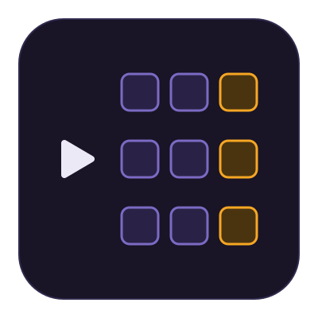

<p align="center"></p>

<h1 align="center">Learning Animated</h1>
<div align="center">
  <!-- PolyForm Noncommercial License -->
  <a href="./LICENSE">
    
  </a>
  <!-- CC License -->
  <a href="./LICENSE-CC-BY-NC">
    
  </a>
  <!-- Version -->
  <a href="https://github.com/josimar-silva/learning-animated/releases">
    
  </a>
  <!-- OSSF Score Card -->
  <a href="https://scorecard.dev/viewer/?uri=github.com/josimar-silva/learning-animated">
    
  </a>
  <!-- CodeQL Advanced -->
  <a href="https://github.com/josimar-silva/learning-animated/actions/workflows/codeql.yaml">
    
  </a>
  <!-- Docker Builds -->
  <a href="https://github.com/josimar-silva/learning-animated/actions/workflows/docker.yaml">
    
  </a>
  <!-- CI -->
  <a href="https://github.com/josimar-silva/learning-animated/actions/workflows/ci.yaml">
    
  </a>
  <!-- CD -->
  <a href="https://github.com/josimar-silva/learning-animated/actions/workflows/cd.yaml">
    
  </a>
  <!-- Deploy -->
  <a href="https://github.com/josimar-silva/learning-animated/actions/workflows/deploy.yaml">
    
  </a>
</div>
<div align="center">
  <strong>Animated learning sites, one per track</strong>
</div>

<div align="center">
  Visualize Kafka, Quarkus, Java, and more, one looping SVG at a time.
</div>

<div align="center">
  <sub>Built with <i>viele</i> ☕️ by
  <a href="https://josimar-silva.com">Josimar Silva</a>.
</div>

## 📖 Table of Contents

- [📝 Introduction](#-introduction)
- [🌐 Sites](#-sites)
- [🔗 Embedding](#-embedding)
- [🏁 Getting Started](#-getting-started)
- [🤝 Contributing](#-contributing)
- [📄 License](#-license)

## 📝 Introduction

Learning Animated is a family of animated learning sites, one per track, plus a home page at learning-animated.com. Each lesson is a looping SVG animated with SMIL, and blog posts, talks, and pull requests embed that same file, like this one:

<p align="center">
  
</p>

All the animations share one look: a near-black plum stage, purple for whatever is stored, one amber accent for what is new, and one red for failure.

## 🌐 Sites

Each track gets its own site on a subdomain of learning-animated.com, and the home page sits at the root.

| Site    | Covers                                                                                           | Status                                                                                                                              |
| ------- | ------------------------------------------------------------------------------------------------ | ----------------------------------------------------------------------------------------------------------------------------------- |
| Kafka   | Kafka internals, chapter by chapter, as an unofficial companion to _Kafka: The Definitive Guide_ | Live at [kafka-animated.josimar-silva.com](https://kafka-animated.josimar-silva.com/) until it moves to kafka.learning-animated.com |
| Quarkus | Quarkus internals                                                                                | Not launched                                                                                                                        |
| Java    | Java and the JVM                                                                                 | Not launched                                                                                                                        |
| Data    | Database indexes, partitioning, and sharding                                                     | Not launched                                                                                                                        |
| Home    | Every live track                                                                                 | Not launched                                                                                                                        |

## 🔗 Embedding

Lesson pages end with an _Embed this animation_ box: a Markdown and an HTML snippet for the lesson's SVG, and a link to download it. Each site serves those SVGs at `/embed/<id>.svg`, or `/embed/<id>.<view>.svg` for a lesson with several views. The lessons are under [CC BY-NC 4.0](LICENSE-CC-BY-NC), so you can embed them in noncommercial work as long as you give credit.

## 🏁 Getting Started

Requires [Node.js](https://nodejs.org/) 24+ and [just](https://just.systems/).

```bash
just install    # install dependencies
just dev kafka  # serve one site: home, kafka, quarkus, java, or data
just test       # run every test suite
just check      # lint, check formatting, and type-check
just build-all  # build every site into its own dist/
```

`just dev` serves the site at [http://localhost:4321](http://localhost:4321) and reloads it as you edit. Run `just` to list every recipe.

## 🤝 Contributing

Contributions are welcome. Please read the [Contributing Guidelines](CONTRIBUTING.md) and the [Code of Conduct](CODE_OF_CONDUCT.md) before opening a pull request. These guides cover the rest:

| Guide                                                          | Read it to                                                                    |
| -------------------------------------------------------------- | ----------------------------------------------------------------------------- |
| [Architecture](docs/architecture.md)                           | See how the packages, tracks, and sites fit together                          |
| [Testing](docs/testing.md)                                     | Learn what each check guards and how to run the browser suite                 |
| [Aesthetic signature](packages/design/signature.md)            | Draw in the house style: palette, utilities, components, and the SVG contract |
| [animate-lesson skill](.github/skills/animate-lesson/SKILL.md) | Add a lesson, test first                                                      |
| [Releasing](RELEASING.md)                                      | Cut a release and deploy it                                                   |

## 📄 License

Copyright (C) 2026 Josimar Silva

Unless otherwise specified:

- **Content:** The lessons, with their animations and text, and the artwork, such as the logo, are licensed under the [Creative Commons Attribution-NonCommercial 4.0 International (CC BY-NC 4.0) License](LICENSE-CC-BY-NC).
- **Source code:** Everything else is licensed under the [PolyForm Noncommercial License 1.0.0](LICENSE).

Neither license allows commercial use. The grants cover this project's own work only, not the book _Kafka: The Definitive Guide_, its figures, or any trademark named in [tracks/kafka/ATTRIBUTION.md](tracks/kafka/ATTRIBUTION.md). Third-party files keep their own licenses, such as the Inter font under the SIL Open Font License 1.1.
